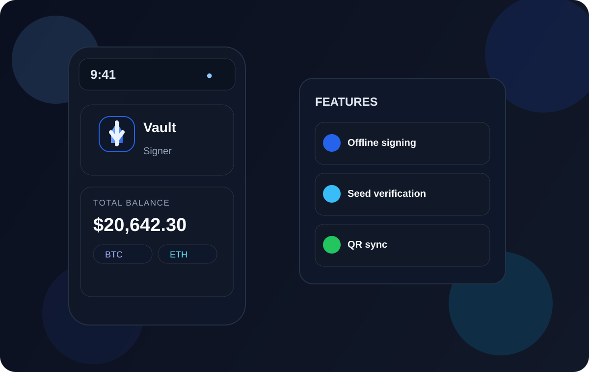

# Vault Signer

  

Air-gapped cold wallet UI for secure offline signing, wallet setup, and transaction review.

## Overview

Vault Signer is a browser-based wallet interface designed to keep keys and signing flows offline. It focuses on a secure experience for:

- creating or importing a wallet seed
- backing up and verifying the recovery phrase
- setting a local PIN
- receiving and reviewing transactions
- syncing balances from a companion app via QR/file import
- signing offline and exporting the signed output

## App preview

  

## Features

- Offline-first wallet experience
- 24-word seed phrase backup flow
- PIN-based access and lock screen
- Receive address and QR export
- Air-gapped transaction signing flow
- Companion sync with public-key-only pairing
- Wallet history and balance views

## Tech stack

- HTML / CSS / JavaScript front-end
- Python-backed host logic for secure wallet handling
- Browser/desktop app-style UI with QR workflows

## Project structure

- `Vault.html` — full UI and styling for the wallet app
- `vault_app.js` — app logic and interaction behavior
- `vault_api.py` — Python interface for wallet operations
- `vault_store.py` — storage logic
- `vault_selftest.py` — self-check / validation script
- `patch_html.py` — helper for patching the HTML app shell

## How to run

1. Open `Vault.html` in a browser to view the app interface.
2. For the full desktop/mobile experience, run the Python host used by the project if available in your local setup.
3. Use the app in offline mode to create, import, pair, and sign wallets.

## Security note

This project is designed for air-gapped workflows: private keys and seed phrases stay on the device, and signing occurs without network exposure.

## Example logo

The project logo in this README is a custom SVG included in the repository at `assets/logo.svg`.

